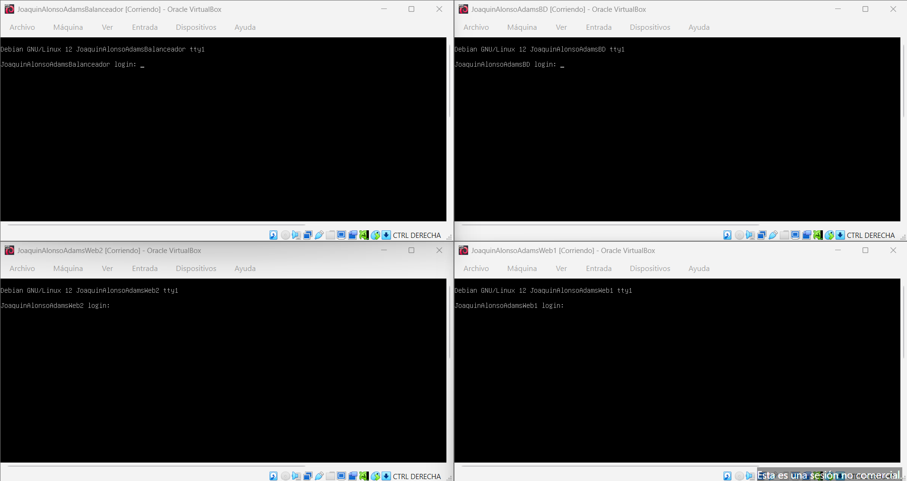
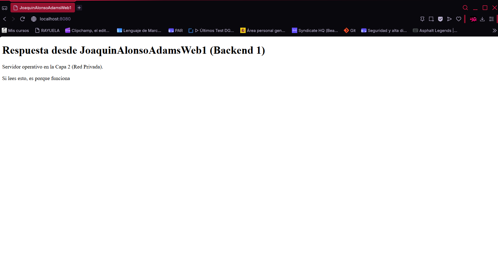
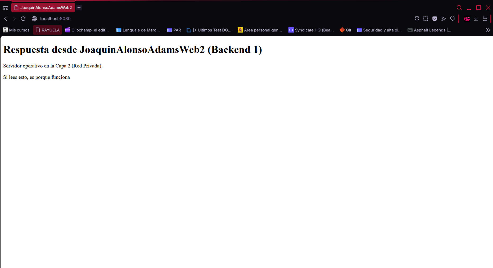
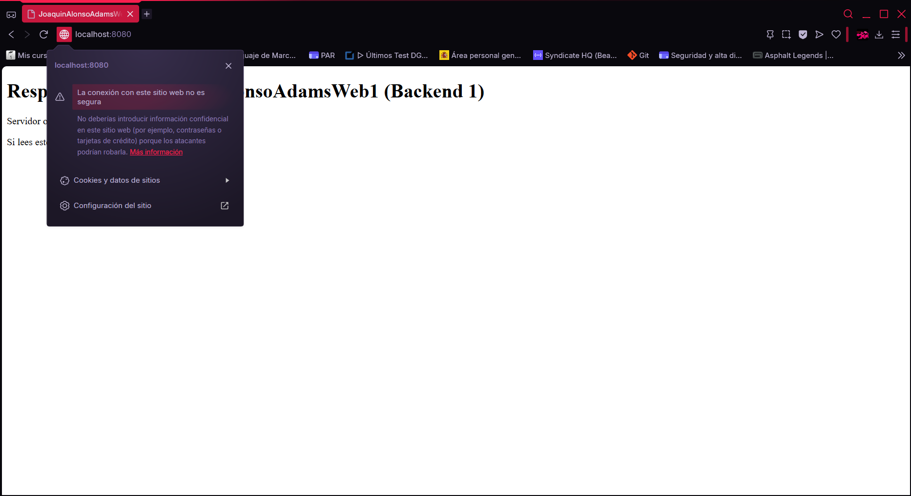
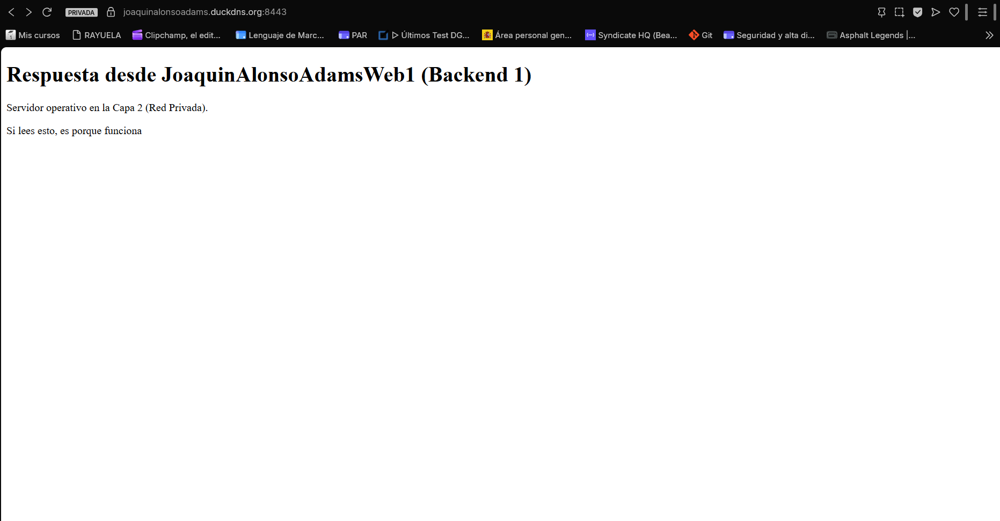
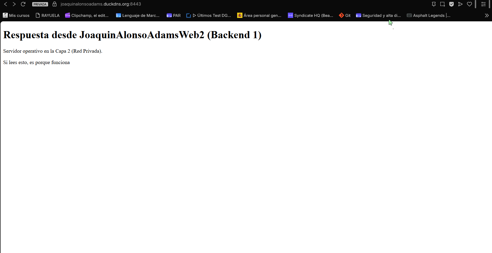
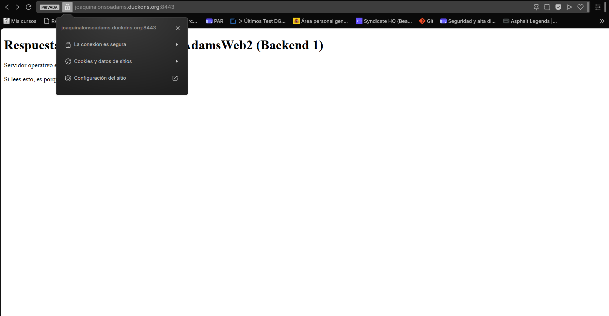

# Balanceador-de-Carga-con-Apache

# Indice
#### 1. Introducción
#### 2. Creando las maquinas virtuales
#### 3. Configurar Servidores de Backend (WEB1 y WEB2)
#### 4. Configurar Servidores de Base de Datos
#### 5. Configurar Balanceador
#### 6. Instalar un certificado valido con certbot (Y probar que funciona mediante duckdns.org)
#### 7. Crear la lista de control de acceso

## Introducción
Se desea montar un escenario de máquinas virtuales con AWS o Maquinas Virtuales, trabajaremos con una infraestructura en tres niveles con:
   1. Un balanceador en capa 1 expuesta a red pública.
   2. Dos servidores web en Backend, capa 2 (red privada).
   3. Un servidor de BBDD en capa 3 (red privada).

Nuestro principal objetivo será montar este escenario donde todas las maquinas estén interconectadas entre si, con una configuración en los servidores web en backend con una ip elástica que le permita poder ser vista por la mayoría de navegadores web, un balanceador que asegure la integridad del sistema ya sea como proxy inverso, certificados https o evitando que se sobrecargue la página y el acceso constante a una base de datos.

## Creando las maquinas virtuales
Cree las 4 maquinas usando Debian-12 Bookworm, 1 Balanceador de Carga llamado JoaquinAlonsoAdamsBalanceador, 2 servidores web en Backend (JoaquinAlonsoAdamsWeb1 y JoaquinAlonsoAdamsWeb2) y Un servidor de BBDD llamado JoaquinAlonsoAdamsBD.

 

Nota 1: Para facilitarme los procesos de configuración correspondientes, opte por usar putty, asignándole un reenvio de puerto para ssh al adaptador NAT. Porque me permite copiar el código desde el documento, de modo que los puertos serian: 2222 para balanceador, 2223 para BD, 2224 para Web1 y 2225 para Web2

Nota 2: Relacionado a lo anterior, hay que tener en cuenta que todos los comandos puestos con sudo, siempre se tienen que usar si configuramos desde la maquina virtual de forma directa, pero como el usuario original (joaquinub) no es parte de los sudoers, me veo en la obligación de entrar como root, con el fin de poder realizar la actividad.

Establecer las direcciones IP dentro de las 4 maquinas, como voy a entrar como root, no necesito sudo:
```
nano /etc/network/interfaces 
```

***Interfaz NAT (Internet)***
```
auto enp0s3
iface enp0s3 inet dhcp
```
***Interfaz Red Interna (IP Estática)***
```
auto enp0s8
iface enp0s8 inet static
    address 192.168.56.10  
    netmask 255.255.255.0
```

Modificaremos la address, usando los siguientes valores para cada uno: .10 para Balanceador, .21 para Web1, .22 para Web2, .30 para DB:
```
sudo systemctl restart networking
```

## Configurar Servidores de Backend
El Backend es la "cara" de nuestro sistema balanceador, es lo que la gente vera o vería si la página web fuera pública, para ello, configuraremos los servidores Web1 y Web2

### Configurando a la maquina WEB1:
Debo instalar el servidor Apache y el cliente de MariaDB para conectarme con la base de datos
```
sudo apt update && sudo apt install apache2 mariadb-client -y
```

Una vez instalado procedo a crear una pagina web sencilla para así asignarla a web1:
```
sudo nano /var/www/html/index.html
```

La pagina web en cuestion:
```
<!DOCTYPE html>
<html>
<head><title>JoaquinAlonsoAdamsWeb1</title></head>
<body>
    <h1>Respuesta desde JoaquinAlonsoAdamsWeb1 (Backend 1)</h1>
    <p>Servidor operativo en la Capa 2 (Red Privada).</p>
    <p>Si lees esto, es porque funciona</p>
</body>
</html>
```

### Configurando a la maquina WEB2:
Debo instalar el servidor Apache y el cliente de MariaDB para conectarme con la base de datos:
```
apt update && apt install apache2 mariadb-client -y
```
Una vez instalado procedo a crear otra pagina web sencilla con el fin de asignarla a web2:
```
sudo nano /var/www/html/index.html
```

La pagina web en cuestion:
```
<!DOCTYPE html>
<html>
<head><title>JoaquinAlonsoAdamsWeb2</title></head>
<body>
    <h1>Respuesta desde JoaquinAlonsoAdamsWeb2 (Backend 1)</h1>
    <p>Servidor operativo en la Capa 2 (Red Privada).</p>
    <p>Si lees esto, es porque funciona</p>
</body>
</html>
```

## Configurando el servidor BBDD:
Para poder configurar un servidor de base de datos, necesitamos tener un sistema gestor, en nuestro caso, instalaremos el servidor de MariaDB:
```
apt update && apt install mariadb-server -y
```

A continuación, configuraremos el archivo de red de MariaDB para permitir conexiones de la red privada.
```
sudo nano /etc/mysql/mariadb.conf.d/50-server.cnf
```

y cambia bind-address = 127.0.0.1 por bind-address = 0.0.0.0 

Después de esto creamos una base de datos y usuario correspondiente:
```
sudo mariadb -u root
```

Dentro de MariaDB crearemos los siguiente
```
CREATE DATABASE practica;
CREATE USER 'joaquin'@'192.168.56.%' IDENTIFIED BY 'mariadb';
GRANT ALL PRIVILEGES ON practica.* TO 'joaquin'@'192.168.56.%';
FLUSH PRIVILEGES;
EXIT;
```

Reiniciamos el servicio con sudo systemctl restart mariadb, ya tenemos configurado el servidor base de datos. Sin embargo, falta una maquina virtual por modificar
```
mysql -h 192.168.56.30 -u joaquin -p con este comando comprobamos que funciona el servidor de base de datos
```

## Configurando balanceador de carga:
Instalar apache:
```
apt update && apt install apache2 -y
```

Habilitar modulos proxy:
```
sudo a2enmod proxy proxy_http proxy_balancer lbmethod_byrequests
nano ~/.bashrc
```

Agregar esta linea para indicarle el PATH al sistema:
```
export PATH=$PATH:/usr/sbin
```

Ejecutar este comando para actualizar el PATH:
```
source ~/.bashrc
```

Se instalaron los modulos si todo va bien, para comprobar que funciono, usaremos:
```
systemctl restart apache2
```

Para el usuario final, no sabe que detrás de la pagina web dado por el balanceador, hay varios servidores y la base de datos, siendo que el mismo balanceador actúa como proxy inverso, la primera linea de defensa para evitar ataques a los servidores web 1 y web 2, mucho menos que accedan a la base de datos.

Ahora toca lo más tedioso, configurar el archivo de configuración de apache (000-default.conf) dentro del balanceador, para que este funcione la pagina web, usaremos el siguiente comando:
```
sudo nano /etc/apache2/sites-available/000-default.conf
```

Esta será la configuración que estaré usando dentro del archivo (OJO: Hay que validar que no haya errores en el archivo de configuración, la mas minima errata lo puede dañar):
```
<VirtualHost *:80>
    ServerName localhost
    ProxyPreserveHost On
    ProxyPass / balancer://mycluster/
    ProxyPassReverse / balancer://mycluster/
    <Proxy balancer://mycluster>
	#La IP de Web1
        BalancerMember http://192.168.56.21 route=web1
	#La IP de Web2
        BalancerMember http://192.168.56.22 route=web2
        ProxySet lbmethod=byrequests
    </Proxy>
</VirtualHost>
```

El comando siguiente sirve para probar las capacidades del apache2:
```
sudo apache2ctl configtest
```

Como se ha realizado una configuración a apache, siempre hay que reiniciar el apache:
```
sudo systemctl restart apache2
```

Si quieres el balanceador de carga, debo usar el navegador conectándome con localhost y usar el reenvio de puertos (8080), cuando entramos, intercambiara entre web 1 y web 2 para evitar que se sobrecargue la pagina.







## Instalar un certificado valido con certbot 
Aunque nos podamos conectarnos a la web, no es una conexión segura, pero para eso esta certificado de Cerbot, que se usa para que la conexión al servidor sea por https (conexión segura), se hace por el puerto 4443 y se usa mediante el protocolo SSL para encriptar el canal de comunicaciones.
```
sudo apt install certbot python3-certbot-apache -y
```

Después de instalar, volvemos a reiniciar apache, sin embargo nos saldrá error de conexión segura (ERR_SSL_PROTOCOL_ERROR o similar) al intentar entrar por https://localhost:8080, y esto se debe a dos motivos técnicos principales en el entorno local con VirtualBox:
- El puerto de red no coincide ya que mapea el puerto anfitrión 8080 hacia el puerto 80 (HTTP) de la máquina virtual, no al puerto 443 (HTTPS). Por lo tanto, solo intentando hablar por HTTPS en un puerto configurado para tráfico plano HTTP.
- Certbot y Let's Encrypt no pueden emitir certificados SSL válidos para localhost ni para IPs privadas, ya que requieren un domínio público accesible desde Internet para validar la seguridad; cosa que no tenemos, ya que lo realizamos via maquinas virtuales.

Para ello, tendremos que simular el uso de certificados con Certbot ya que esta solo funciona con ip´s publicas, las maquinas tienen ip´s privadas, por lo tanto, no podrán usar correctamente el certificado.

Para poder simularlo, necesitamos de un dominio real (gratuito), en nuestro caso usaremos duckdns.org, introduciremos el nombre del dominio y ya deberíamos tenerlo (Ojo con el Token, es importante), en mi caso lo llame "joaquinalonsoadams.duckdns.org"

Ya que tenemos Cerbot instalado podemos pasar a crear los certificados en si, crearemos el registro TXT (una clase de DNS), para crear un registro TXT usaremos el siguiente comando
```
https://www.duckdns.org/update?domains={YOURVALUE}&token={YOURVALUE}&txt={YOURVALUE}[&verbose=true][&clear=true]
```

{YOURVALUE} los valores pedidos para crear el registro, el "domains" y el "token" aparecen al crear nuestro primer dominio, para saber el valor de txt, usaremos el siguiente comando para configurar cerbot manualmente:
```
sudo certbot certonly --manual --preferred-challenges dns -d joaquinalonsoadams.duckdns.org
```

Una vez puesto el comando, les preguntara el correo electronico si quieren que Letsencrypt sea quien ejecute el proceso y luego si quieres reccibir inofrmación de la Electronig Frontier Federation (No lo muestro ya que por accidente borre la pantalla, igualmente, una vez realizado el proceso, deberia quedar una pantalla mencionando sobre permitir a DNS TXT bajo el nombre visto
```
Successfully received certificate.
Certificate is saved at: /etc/letsencrypt/live/joaquinalonsoadams.duckdns.org/fullchain.pem
Key is saved at:         /etc/letsencrypt/live/joaquinalonsoadams.duckdns.org/privkey.pem
This certificate expires on 2027-02-14.
These files will be updated when the certificate renews.
```

Estos certificados hay que indicarlos en la configuración de apache, para ello volveremos a:
```
/etc/apache2/sites-available/000-default.conf
```

Definimos el clúster una sola vez a nivel global para que ambos puertos puedan usarlo:
```
<Proxy balancer://mycluster>
    BalancerMember http://192.168.56.21 route=web1
    BalancerMember http://192.168.56.22 route=web2
    ProxySet lbmethod=byrequests
</Proxy>
```

Puerto 80 (HTTP): Redirige automáticamente todo el tráfico a HTTPS
```
<VirtualHost *:80>
    ServerName joaquinalonsoadams.duckdns.org
    Redirect permanent / https://joaquinalonsoadams.duckdns.org:8443/
</VirtualHost>
```
Puerto 443 (HTTPS): Sirve el certificado SSL real de Certbot y balancea la carga
```
<VirtualHost *:443>
    ServerName joaquinalonsoadams.duckdns.org

    SSLEngine on
    SSLCertificateFile /etc/letsencrypt/live/joaquinalonsoadams.duckdns.org/fullchain.pem
    SSLCertificateKeyFile /etc/letsencrypt/live/joaquinalonsoadams.duckdns.org/privkey.pem

    ProxyPreserveHost On
    ProxyPass / balancer://mycluster/
    ProxyPassReverse / balancer://mycluster/
</VirtualHost>
```

Al haber realizado las siguientes modificaciones, os puede salir un error indica la falta de un modulo SSL, con este usaremos el siguiente comando
```
sudo a2enmod ssl
```

Una vez realizado, verificamos la configuración y reseteamos. Como podemos ver, intentar acceder a localhost se nos será imposible aquí, ya que (tuve que abrir una pestaña de incognito debido a un error con el cache). Para poder acceder a la pagina web requeriremos de añadir el puerto 8443 y luego indicar dentro del system32, el localhost el nombre del dominio para que así redirija las conexiones al localhost, esto a falta de una IP real.

***CUIDADO A LA HORA DE USAR EL CMD EN EL SYSTEM32***

Dentro del CMD, como administrador accederemos con cd C:\Windows\System32\drivers\etc, una vez allí, realizaremos Notepad hosts y añadiremos la linea
```
127.0.0.1    joaquinalonsoadams.duckdns.org
```

Una vez lo escribis, dejad espacio fuera y entrad de nuevo a localhost:8080, ya debería conectarse:







Como pueden ver ahora... La conexión es segura, todo ello gracias al certificado de cerbot y letsencrypt

## Crear la lista de control de acceso:
Estas se encargan de que la conexión pase unica y exclusivamente por los puertos y/o conexiones de cada maquina virtual

Configuración para el balanceador de cargas: Es la única expuesta al exterior. Debe permitir tráfico público de Internet en los puertos web (80 para HTTP y 443 para HTTPS), además del puerto de administración (22 para SSH).
```
sudo apt install ufw -y
sudo ufw default deny incoming
sudo ufw default allow outgoing
sudo ufw allow 80/tcp
sudo ufw allow 443/tcp
sudo ufw allow 22/tcp
sudo ufw enable
```

Configurar JoaquinAlonsoAdamsWeb1 & JoaquinAlonsoAdamsWeb2: Deben estar completamente protegidos del exterior. Su grupo de seguridad bloquea el tráfico de Internet y solo permite peticiones HTTP (80) procedentes exclusivamente de la IP del balanceador.
```
sudo apt install ufw -y
sudo ufw default deny incoming
sudo ufw default allow outgoing
sudo ufw allow from 192.168.56.10 to any port 80 proto tcp
sudo ufw allow 22/tcp
sudo ufw enable
```

Configurar JoaquinAlonsoAdamsBD: Es el nivel más crítico y aislado. Bloquea cualquier conexión general y solo permite tráfico en su puerto específico (por ejemplo, el 3306 de MariaDB) procedente exclusivamente de los servidores web de la Capa 2.
```
sudo apt install ufw -y
sudo ufw default deny incoming
sudo ufw default allow outgoing
sudo ufw allow from 192.168.56.21 to any port 3306 proto tcp
sudo ufw allow from 192.168.56.22 to any port 3306 proto tcp
sudo ufw allow 22/tcp
sudo ufw enable
```


